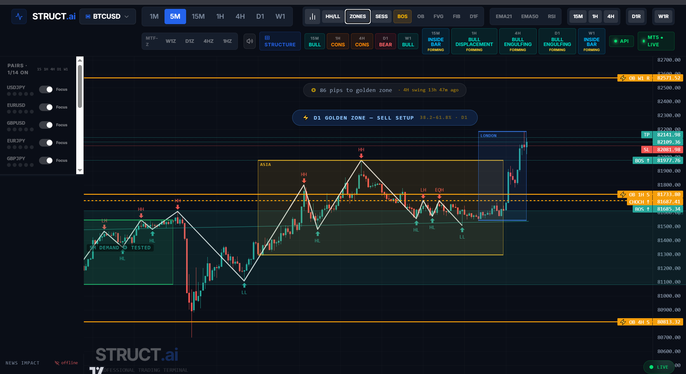
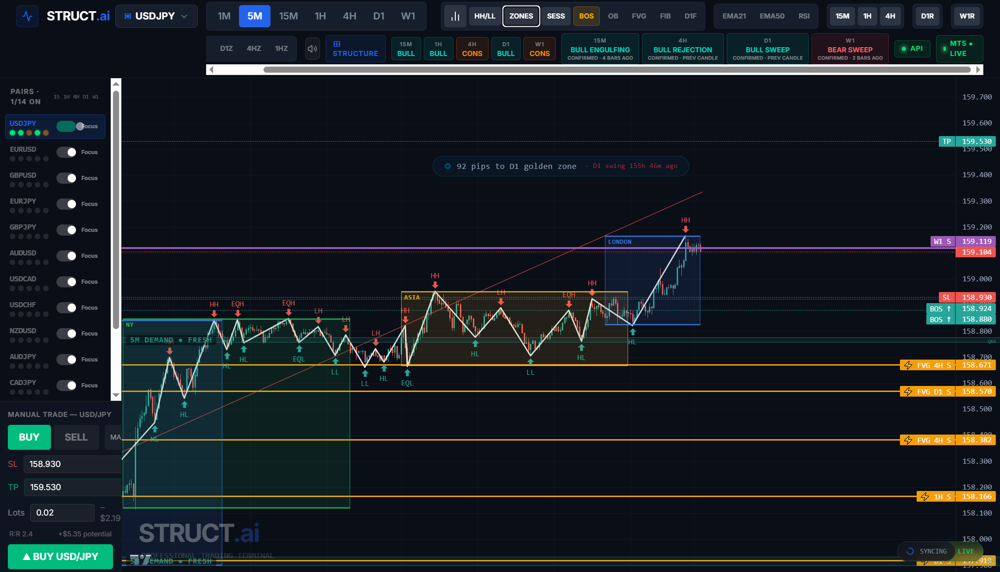
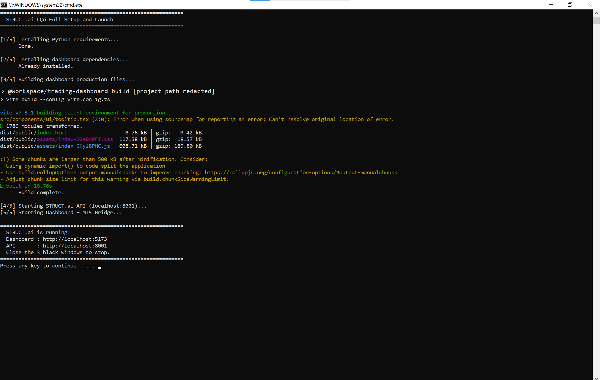
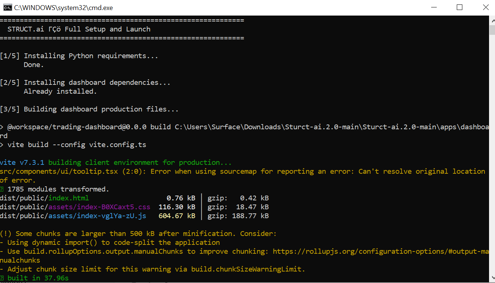
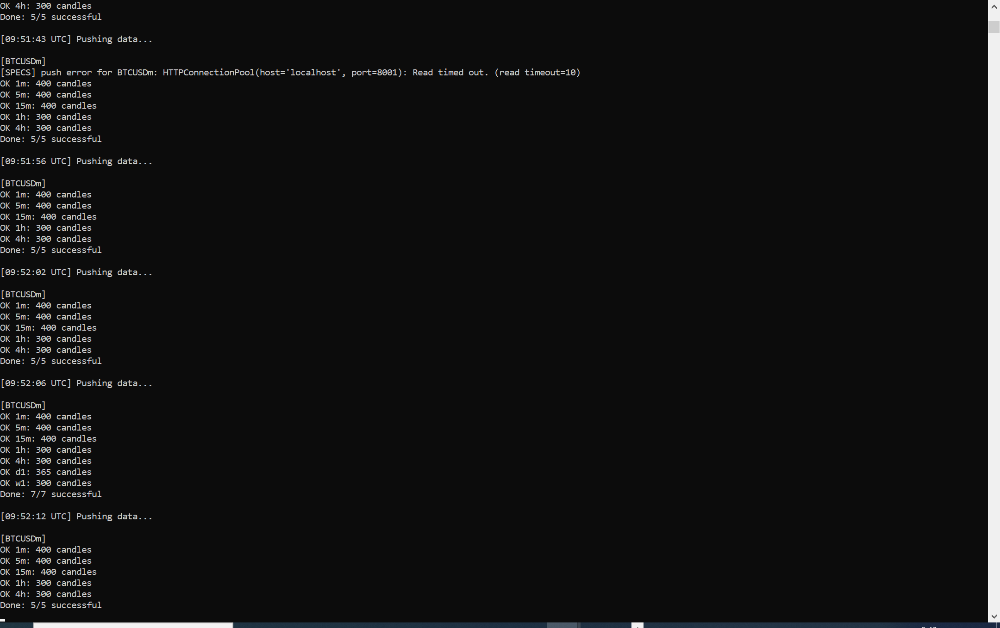

# STRUCT-AI 2.0

STRUCT-AI is a Windows-first, locally run market-structure analysis dashboard for MetaTrader 5 (MT5). It combines a Python/FastAPI service, a Python bridge to a running MT5 terminal, and a React/TypeScript dashboard. The analysis is deterministic rule-based code; it is not a trained AI model, broker, backtester, or claim of profitable trading.

> **Trading risk:** Analysis labels and framework summaries are descriptive software output, not financial advice or verified trade signals. Manual orders can reach the connected MT5 account. Validate every order and calculation on a demo account before any live use.

## What the application does

1. The MT5 bridge reads candles and symbol specifications from one already-running MT5 terminal.
2. It sends data for the symbols enabled in the dashboard watchlist to the local FastAPI service.
3. The API keeps a rolling candle history in memory and runs the market-structure engines.
4. The dashboard fetches analysis through REST endpoints, refreshes when candle events arrive over WebSocket, and draws chart overlays and panels.
5. Manual orders submitted in the dashboard are queued by the API. The bridge polls the queue, submits requests to MT5, and reports order results and position snapshots.

The project currently supports these API symbols: USD/JPY, EUR/USD, GBP/USD, AUD/USD, USD/CHF, EUR/JPY, GBP/JPY, USD/CAD, NZD/USD, AUD/JPY, CAD/JPY, XAU/USD, BTC/USD, and DXY. Supported intervals are M1, M5, M15, H1, H4, D1, and W1. Broker-specific MT5 names use the `m` suffix by default (for example, `USDJPYm`); edit `MT5_SYMBOL_SUFFIX` in the bridge if your broker uses another naming convention.

## Architecture and data flow

```text
MetaTrader 5 terminal (Windows; already open)
        │  candles, symbol properties, positions
        ▼
apps/trading-backend/mt5-bridge/mt5_bridge.py
        │  authenticated HTTP requests
        ▼
FastAPI service (port 8001; /trading-api)
  in-memory candle/spec/order stores + analysis engines
        │  REST responses and candle events
        ▼
React dashboard (port 5173)
  chart, analysis panels, watchlist and manual trade controls
```

The bridge refuses to connect if it cannot inspect Windows processes reliably, if no MT5 terminal is running, or if more than one terminal is running. After connecting, it records the account login and server identity and pauses data/order activity if that identity or terminal process changes. It does not launch MT5 itself.

The bridge polls enabled symbols on a five-second cycle. Intraday frames are fetched on each cycle; D1 and W1 are refreshed about once per minute. The API stores the latest 300–400 candles per symbol and interval in process memory (the precise cap is in `services/mt5_store.py`). Restarting the API clears candle history; the bridge repopulates it. The active-symbol watchlist is saved separately in `apps/trading-backend/data/active_symbols.json` and falls back to four default symbols if the file is missing or invalid.

## Dashboard

The dashboard is a Vite, React, TypeScript, and TanStack Query application using lightweight-charts. The root route chooses a desktop or mobile dashboard based on viewport width; `/structure` opens a multi-timeframe structure view.

- **Chart and overlays:** candles, swing/ZigZag lines, HH/HL/LH/LL labels, BOS/CHoCH markers, supply/demand zones, higher-timeframe zones, S/R levels, sessions, order blocks, FVGs, Fibonacci levels, EMA 21/50, and RSI. Available layers depend on the returned analysis and toggles.
- **Symbol and timeframe controls:** choose from enabled watchlist symbols and the seven supported intervals. The same enabled-symbol list determines what the bridge streams and what appears in the chart symbol selector.
- **Market context:** multi-timeframe bias and pattern badges, a currency heatmap/sidebar, market narrative, environment ratings, and framework status.
- **Manual trade panel:** market or limit requests, entry/SL/TP controls, position snapshots, order results, and close controls. The bridge may reject orders if the account, symbol, volume, price, or broker rules do not allow them.
- **Live refresh:** TanStack Query handles polling and caching; the dashboard also listens to `/trading-api/ws` candle events and uses periodic polling as a fallback.
- **Responsive/mobile view:** `MobileDashboard.tsx` presents the chart workflow on narrower screens. Shared chart and market components live under `src/components/`.

The `src/components/ui/` directory contains 55 reusable UI primitives (Radix/shadcn-style controls such as dialogs, menus, inputs, tabs, tables, and toasts); these are presentation building blocks rather than trading engines.

## Analysis engines

The active calculation modules are in `apps/trading-backend/services/`:

| Module | Purpose |
|---|---|
| `zigzag_engine.py` | Fractal swing highs/lows, alternation, and timeframe/instrument movement filters |
| `structure_engine.py`, `trend_engine.py` | HH/HL/LH/LL and equal-high/low classification; current structural bias |
| `bos_engine.py`, `choch_engine.py` | Close-based Break of Structure and Change of Character events |
| `zones_engine.py` | Supply/demand clustering, candle-derived bounds, freshness, retests, and heuristic quality |
| `mtf_sr_engine.py` | Multi-timeframe support/resistance clustering, broker precision sizing, recency/rejection scores, and deduplication |
| `trendline_engine.py` | Least-squares lines through higher lows/lower highs and invalidation checks |
| `framework_checker.py` | Order-block detection and a rule-based limit-framework readiness/R:R summary |
| `fvg_engine.py`, `confluence_engine.py` | Fair Value Gaps and alignment of S/R with zones, order blocks, and FVGs |
| `candle_pattern_engine.py` | Structural-context pin bars, engulfing patterns, liquidity sweeps, displacement, and inside bars |
| `atr_utils.py`, `momentum_engine.py`, `indicator_engine.py` | ATR, volatility/body/impulse measures, EMA 21/50, RSI 14, and moving-average state |
| `session_engine.py` | Asian, London, and New York session ranges from candle timestamps; New York hours adjust for US DST |
| `narrative_engine.py` | Rule-based plain-language structure, session, confidence, environment, style, and exhaustion summaries |
| `pip_utils.py` | Shared pip size and coarse asset-class helpers, including an explicit DXY rule |
| `data_service.py`, `mt5_store.py` | Read/serialize the rolling in-memory candle store |
| `symbol_settings.py`, `symbol_specs_store.py` | Persist the symbol watchlist and cache broker contract/tick metadata in memory |
| `auth_service.py`, `bridge_auth.py` | Session/payload security helpers and the shared MT5 bridge key |

These algorithms are heuristics. Their thresholds and scores are code-defined, depend on broker candles/specifications, and have not by themselves established predictive accuracy or profitability. The news-status lookup is an optional HTTP integration configured with `NEWS_SERVICE_URL` (default `http://localhost:5003`); the news data service is not included in this repository, and lookup failures currently do not block the analysis.

## API reference

The live FastAPI app is mounted under `/trading-api`. Interactive documentation is available at `http://localhost:8001/docs` while the API is running.

| Routes | Use |
|---|---|
| `GET /health` | Process health response |
| `POST /auth/login` | Dashboard login and session-token issue |
| `GET /data` | Retrieve serialized OHLC candles |
| `GET /analysis` | Combined chart analysis, optionally including EMA/RSI |
| `GET /structure`, `/trend`, `/bos`, `/choch` | Swing/structure labels, bias, BOS, or CHoCH |
| `GET /zones`, `/zones-mtf`, `/sr-levels`, `/confluence` | Zones, multi-timeframe S/R and aligned confluence |
| `GET /patterns`, `/pattern-summary`, `/sessions`, `/mtf-bias`, `/bos-choch` | Pattern, session, multi-timeframe bias, and event summaries |
| `GET /narrative`, `/pair-sweep`, `/environment-history`, `/framework-status` | Plain-language context, environment ratings/history, and framework readiness |
| `POST /mt5/push`, `POST /mt5/push-specs` | Authenticated bridge writes for candles and symbol metadata |
| `GET /mt5/status`, `/mt5/server-time`, `/mt5/specs`, `/mt5/active-symbols` | Bridge/data status, broker timestamp, symbol metadata, and bridge watchlist |
| `POST /trade/open`, `POST /trade/close` | Queue a manual order or position close |
| `GET /trade/pending`, `POST /trade/result`, `GET /trade/results` | Bridge order polling and result exchange |
| `GET /trade/positions`, `POST /trade/positions/sync` | Dashboard position snapshots and bridge sync |
| `GET /trade/inflight`, `POST /trade/breakeven-moved`, `GET /trade/breakeven-status` | Queued-order diagnostics and framework breakeven state |
| `GET /symbols/settings`, `PUT /symbols/settings` | Read/update enabled symbols |
| `WS /ws` | Broadcast candle update events |

Paths in this table are relative to `/trading-api`. The dashboard's Vite server and preview proxy that prefix to the local API on port 8001.

## Setup on Windows

### Requirements

- Windows and MetaTrader 5 installed, open, and signed into the intended account.
- Python 3.11 or later, Node.js, and pnpm.
- A broker whose symbol names can be mapped by `MT5_SYMBOL_SUFFIX` and the configured symbol list.

### Isolated Python setup

The convenience batch launchers use the system/user Python installation and may install packages into that environment. To keep project packages separate, use a virtual environment and run the services from the activated environment:

```powershell
python -m venv .venv
.\.venv\Scripts\Activate.ps1
python -m pip install --upgrade pip
python -m pip install -r apps/trading-backend/requirements.txt
python -m pip install requests MetaTrader5 "qrcode[pil]"
pnpm install
```

The backend requirements include FastAPI, Uvicorn, pandas, NumPy, HTTPX, WebSockets, dotenv, bcrypt, PyOTP, PyJWT, and cryptography. The MT5 Python package is Windows-specific. `install_requirements.bat` and `STRUCT-AI.bat` instead use `pip install --user`; review those scripts if you do not want packages installed to your user Python environment.

### Create local authentication and start

On a fresh checkout, create the local authentication configuration once:

```powershell
Set-Location apps/trading-backend
python generate_secrets.py
```

This creates a private `.env` and `totp_qr.png`. Keep the QR image and `.env` out of commits and screenshots. When the API starts, it creates/persists `MT5_BRIDGE_SECRET` in that `.env` if needed. The bridge and API read the same local key.

For an isolated setup, keep the virtual environment activated and start the API from the backend directory, the bridge from its directory, and the dashboard from the repository root in separate terminals:

```powershell
# Replace this example with the actual project folder, then repeat in each terminal.
$ProjectRoot = "C:\path\to\STRUCT-AI"
Set-Location $ProjectRoot
.\.venv\Scripts\Activate.ps1
Set-Location apps/trading-backend
python main.py

# Terminal 2 (repeat the path assignment and activate the environment; after API creates the key)
$ProjectRoot = "C:\path\to\STRUCT-AI"
Set-Location $ProjectRoot
.\.venv\Scripts\Activate.ps1
Set-Location apps/trading-backend/mt5-bridge
python mt5_bridge.py

# Terminal 3 (repeat the path assignment and activate the environment here too)
$ProjectRoot = "C:\path\to\STRUCT-AI"
Set-Location $ProjectRoot
.\.venv\Scripts\Activate.ps1
pnpm --filter @workspace/trading-dashboard run build
pnpm --filter @workspace/trading-dashboard run serve
```

Open `http://localhost:5173`; the API is at `http://localhost:8001`. For Vite development mode, use `pnpm --filter @workspace/trading-dashboard run dev` instead of the production build/serve commands. `STRUCT-AI.bat` is the one-click alternative and installs dependencies, builds, starts the API/bridge/dashboard, and opens Chrome.

**Current login behavior:** `generate_secrets.py` asks for a login password and a separate encryption passphrase. The local API login path currently checks the dashboard's **Password** field against the encryption passphrase; the dashboard's **Encryption Passphrase** field is then used to derive the browser encryption key. The TOTP code is not checked on the localhost path. This mismatch should be corrected in the application before treating the login UX as complete. Do not enable `STRUCT_DEVICE_KEY` for this dashboard: its current client does not send that field. Remote use is not ready: CORS is configured for localhost, the WebSocket is exempt from the HTTP auth/encryption middleware, and several status/bridge routes are intentionally plain HTTP JSON. Keep the whole stack private/local and do not expose its ports to the public internet.

## Repository map

```text
STRUCT-AI/
├── apps/
│   ├── dashboard/                 React/Vite dashboard application
│   │   ├── public/                 favicon and Open Graph image
│   │   └── src/
│   │       ├── App.tsx, main.tsx   route selection, query client, login gate, error boundary
│   │       ├── components/         chart, trade panel, heatmap, narrative, login and status UI
│   │       │   └── ui/             reusable Radix/shadcn-style primitives
│   │       ├── hooks/              API queries, watchlist mutations, mobile detection
│   │       ├── lib/                class-name helper and active secure-fetch client
│   │       └── pages/              desktop, mobile, structure, not-found pages
│   └── trading-backend/            Python/FastAPI application and MT5 bridge
│       ├── main.py                 app setup, middleware, router registration, WebSocket
│       ├── routers/                HTTP route handlers grouped by API area
│       ├── services/               stores, auth and analysis engines
│       ├── mt5-bridge/              Windows-only MT5 data/order process
│       ├── data/                   local persisted watchlist (created at runtime)
│       ├── .env                    local secrets (created locally; do not commit)
│       ├── generate_secrets.py      local password/TOTP/passphrase setup
│       └── generate_device_key.py   optional key generator; current dashboard cannot submit its key
├── packages/
│   ├── api-client-react/            generated React Query client and generic fetch helper
│   ├── api-spec/                    small OpenAPI sample and Orval configuration
│   ├── api-zod/                     generated Zod types/schemas for that sample
│   └── db/                          Drizzle/PostgreSQL starter package with an empty schema
├── tools/scripts/                   small TypeScript workspace script
├── docs/screenshots/                committed dashboard/build/bridge screenshots
├── archive/
│   ├── backups/                     dated snapshots of prior app versions and experiments
│   ├── legacy-launchers/            older Windows launchers/shortcuts
│   └── unverified/                  unverified starter executable; not required by the app
├── STRUCT-AI.bat                    convenience install/build/start script
├── START_HERE.bat                   quick-start directions
├── start_api.bat, start_bridge.bat  launch one Python process each
├── install_requirements.bat         user-level Python dependency installer
├── package.json                     pnpm workspace scripts
├── pnpm-workspace.yaml              workspace/catalog/security-age policy
├── pnpm-lock.yaml                   JavaScript dependency lockfile
├── pyproject.toml, uv.lock          root Python project metadata/lock
└── tsconfig*.json, .npmrc           TypeScript and pnpm configuration
```

### Active backend routers

- `routers/data.py` serves OHLC data.
- `routers/structure.py` connects the analysis engines to structure, trend, BOS/CHoCH, zone, pattern, session, bias, S/R, confluence, and combined-analysis endpoints.
- `routers/narrative.py` assembles multi-timeframe narrative, pair environment, history, and framework responses; news lookup is external and optional.
- `routers/mt5.py` accepts authenticated bridge candle/specification pushes and serves bridge/specification status.
- `routers/trading.py` queues manual orders, tracks in-flight orders/results, exposes position snapshots, and accepts bridge breakeven updates.
- `routers/symbol_settings.py` reads/writes the watchlist and serves the bridge's authenticated watchlist endpoint.
- `routers/auth.py` implements login. There is currently no `/auth/revoke-all` handler even though the unused optional panic UI references that path.
- `routers/daily_pnl.py` reads today's closing deals from the MT5 Python integration.

### Dashboard source files

- `components/TradingChart.tsx` owns the lightweight-charts view and HTML/chart overlays.
- `components/TradePanel.tsx` submits manual trade requests and polls position/order status.
- `components/TopBar.tsx` provides symbol/timeframe/layer controls and status/bias/pattern badges.
- `components/HeatmapSidebar.tsx` contains the watchlist/market-context sidebar.
- `components/MarketNarrative.tsx` renders the API's narrative and framework context.
- `components/LoginGate.tsx` wraps the app with the current login flow; `PanicButton.tsx` is optional UI not enabled by default.
- `components/RSIPane.tsx` renders RSI separately; `components/ui/` contains reusable controls.
- `hooks/use-trading-api.ts` defines API response types and query hooks; `hooks/use-symbol-settings.ts` loads/saves the enabled-symbol list.
- `lib/secureApi.ts` is the active fetch wrapper imported by `LoginGate`; `src/secureApi.ts` is a duplicate/older copy and is not the imported path. `lib/utils.ts` contains class-name helpers.
- `pages/Dashboard.tsx` and `pages/MobileDashboard.tsx` compose the primary views; `pages/StructurePage.tsx` provides additional structure context; `pages/not-found.tsx` handles unknown routes.
- `hooks/Main.javafile` and `components/New Text Document.txt` are empty stray placeholders, not app modules.

### Workspace scaffolding and generated output

The live trading API is implemented in `apps/trading-backend`; it is not described by `packages/api-spec/openapi.yaml`, which currently contains only a separate sample `/api/healthz` endpoint. The Orval configuration still writes to the former root `lib/` layout rather than `packages/`, so API code generation is not currently aligned with the live app. `packages/db` is an optional PostgreSQL/Drizzle starter; the trading backend uses in-memory candles and does not use this database package. `tools/scripts` contains a hello-world TypeScript script. These packages are workspace scaffolding, not required services in the MT5-to-dashboard runtime path.

`node_modules/`, `.pnpm-store/`, Python caches, and dashboard build output are installed/generated files. They are not source. Root `artifacts/` and `lib/` may remain as empty remnants of an earlier layout. `archive/backups/` preserves dated historical code, including removed auto-trading and CHoCH-monitor experiments; do not treat those snapshots as active behavior. The executable under `archive/unverified/` is unverified and is not part of setup.

## Security, configuration, and known limitations

- Keep `.env`, `totp_qr.png`, local watchlist data, broker identifiers, logs, and account screenshots private. The ignore rules cover the backend environment file, local data, and QR image; inspect `git status` before committing.
- `MT5_BRIDGE_SECRET` is required for bridge candle/specification writes, watchlist reads, and order-poll/result/position callbacks. The API creates a local key if missing; the bridge exits if it cannot read one.
- Authentication middleware is active only when all required auth variables are configured. Some endpoints (including health, WebSocket, bridge endpoints, status, and broker time) are exempt from that HTTP middleware by design. This implementation has not been security-reviewed for remote deployment.
- `generate_device_key.py` can add an optional remote-login key, but the current dashboard login client does not send a device key. The current panic-session button also calls an API route that does not exist.
- The API and Vite servers bind to `0.0.0.0`; use a trusted local network/firewall and do not forward or publish these ports. A private workstation setup is the intended operating mode.
- Live candles, symbol specs, positions, queues, and status histories are process-memory data and reset when the API restarts, except for the symbol watchlist saved to JSON.
- Broker symbol suffixes, tick sizes, contract properties, market hours, candle quality, and execution rules vary. The bridge reports the configured symbols and broker metadata; check them against your terminal.
- The repository currently contains no dedicated automated test suite. The screenshots document selected local runs only; they do not establish correctness across all symbols, brokers, timeframes, or trade scenarios.

## Screenshots

These are examples from local runs, not performance or accuracy claims:

The supplied local-run captures show the dashboard rendering a USD/JPY 5-minute chart with analysis overlays, the API indicator, and the MT5 live indicator. The accompanying API log records successful responses for the dashboard's analysis, multi-timeframe zones, support/resistance, bias, sessions, pattern summary, and confluence requests, plus an accepted WebSocket connection. The bridge log shows repeated candle batches accepted across supported intervals. These observations describe the supplied run only; they do not guarantee continuous connectivity or validate trade execution.

The same logs also show intermittent localhost request timeouts and Windows MT5 process-inspection timeouts. During those interruptions, the bridge paused orders while it could not verify the active account/terminal, and reported recovery after reconnecting. The supplied build capture reports a successful Vite production build (1,785 modules, about 38 seconds) with a source-map location warning in `src/components/ui/tooltip.tsx` and a bundle-size warning for the approximately 605 kB JavaScript chunk. The warnings did not stop that captured build. The build and runtime observations were supplied by the project owner and were not rerun during this documentation update.

### Dashboard



### Latest live dashboard capture



### Dashboard build and launch



### Latest production build capture



### MT5 bridge data stream


